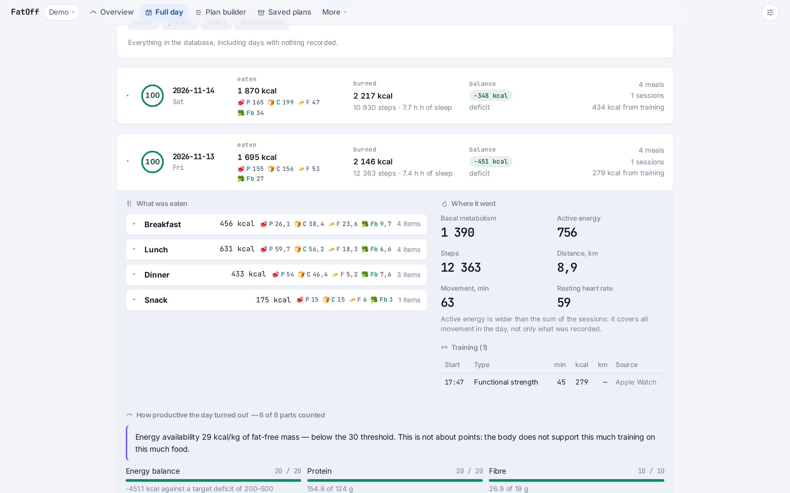
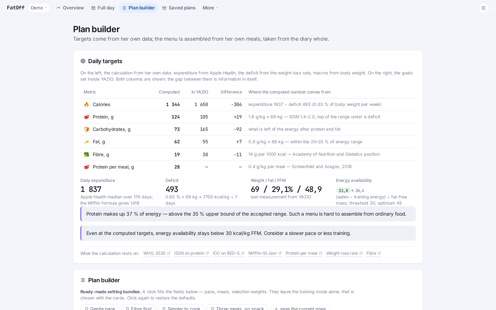
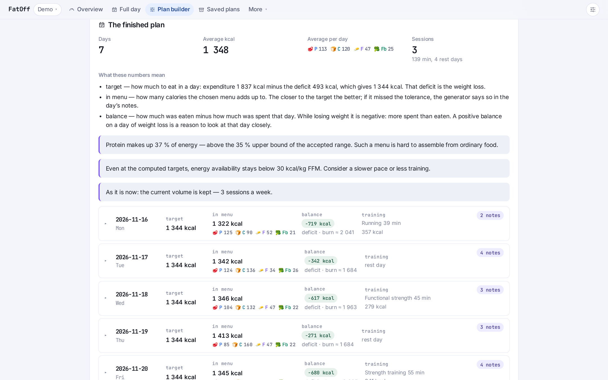
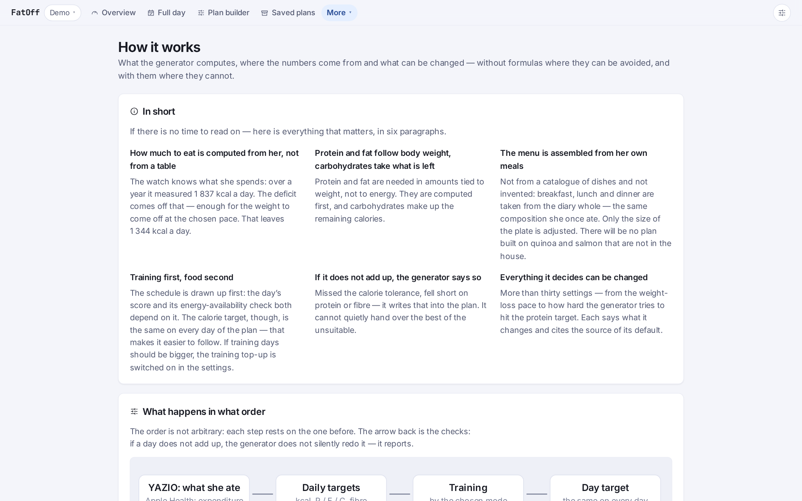
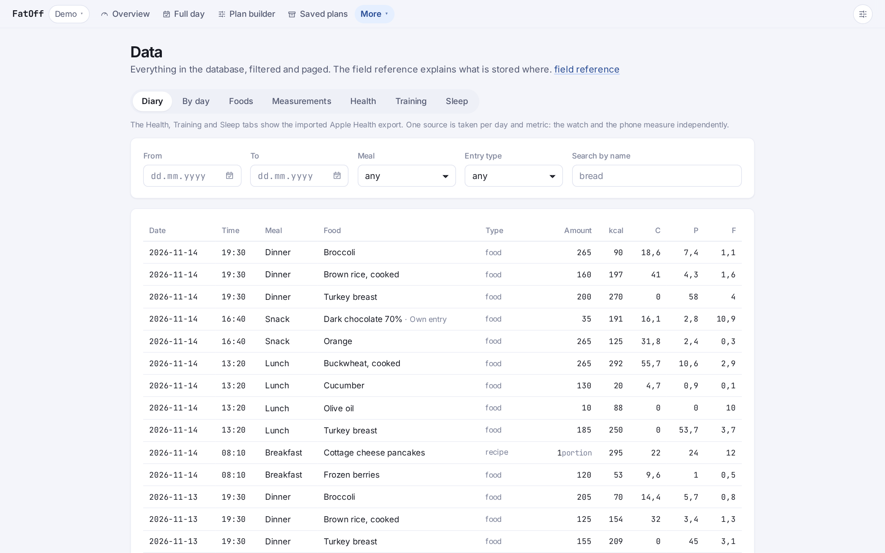
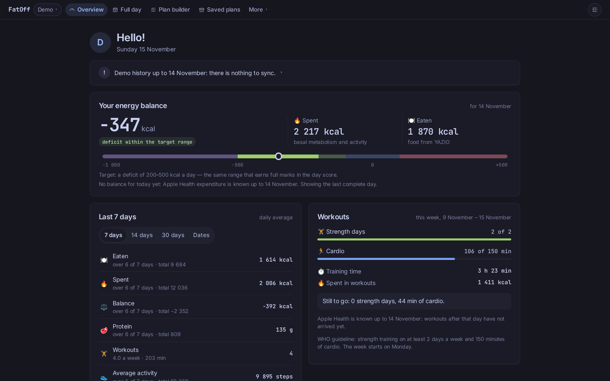
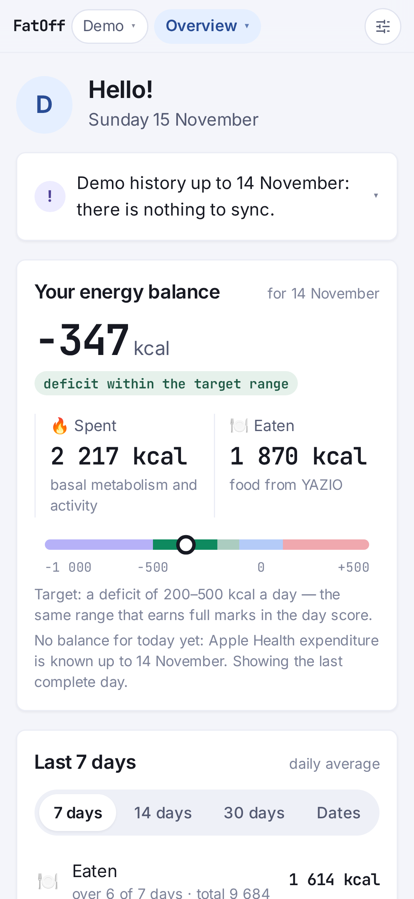

# FatOff

**English** · [Русский](README.ru.md)

A self-hosted service that mirrors a [YAZIO](https://www.yazio.com/) account into
its own database, merges it with an Apple Health export, shows the whole picture
in the browser and builds files that can be handed to a language model for
analysis. On top of that data sits a meal and training planner that composes
days out of the person's own diary.

It runs locally in Docker, behind a password. Nothing about a person's health
leaves the machine: exports are built offline, fonts are bundled, and the page
with health data makes no external requests.

> The project is not affiliated with YAZIO or Apple. The YAZIO API it talks to
> is undocumented and may change at any time. Nothing here is medical advice.


<sub>All screenshots show the built-in demo account: made-up history, no real person's data.</sub>

## What it does

- **Sync a YAZIO account** — by e-mail and password, or with a ready token for
  accounts that sign in with Apple ID and have no password at all. The first run
  pulls the whole history since registration; later runs fetch only what changed,
  thanks to a cheap detector built on daily totals.
- **Import Apple Health** — a 2 GB export is parsed in about 20 seconds
  (4.4 million records, 95 types, 8.6 years). It can be dropped into a folder or
  picked up from Google Drive on a schedule; a file seen before is recognised by
  checksum and skipped.
- **Join intake with expenditure** — YAZIO knows what was eaten, Apple Health
  knows what was burnt. Together they give an energy balance per day.
- **Home screen** — balance of the last complete day against a target corridor,
  recent days as "eaten vs burnt", the week's training against the WHO norm,
  today's nutrition and a short analysis in words. Every number says where it
  came from and how many days it is based on.
- **Day in full** — intake and expenditure side by side, every meal expandable
  down to its ingredients, workouts broken down, and a day score with an
  explanation.
- **Planner** — targets computed from the person's own data (not from tables),
  shown next to the YAZIO goals. A plan for a day, week, month or any period:
  breakfast, lunch and dinner are taken *whole* from the diary and scaled by a
  single factor, and training is scheduled in one of four modes. A finished plan
  can be edited by hand — swap, rescale or pin a dish — and is recomputed on the
  server.
- **Saved plans** — tags, search, pagination and a one-file PDF export.
- **Exports** for a period in four formats:

  | Format | What it is | When to use |
  |---|---|---|
  | **Markdown** | a ready report: profile, summary, daily series, top foods, micronutrients, data quality | paste into an AI chat |
  | **TOON** | all tables with column names once per header — about 3× more compact than JSON | long history, saving tokens |
  | **JSON** | full machine dump of every table | your own processing |
  | **CSV** | one file per table, zipped | Excel and analysis tools |

- **Several accounts**, each with its own sync and Drive schedules.
- **Demo account** — one button creates six months of made-up but plausible
  history (diary, steps, sleep, workouts, weigh-ins, a ready plan). It is stored
  in the same tables and computed by the same code as real data: there is no
  "if demo" branch anywhere.

The interface is bilingual (Russian and English) — labels, setting descriptions,
the field reference, the planner's built-in documentation and the PDFs. It has
light and dark modes in four colour schemes (Tokyo Night, Catppuccin, Nord,
Graphite).

## Screenshots

**Full day** — intake and expenditure side by side, each meal expandable, workouts and the day score with its reasons:



**Plan builder** — targets from the person's own data next to the YAZIO goals, every number with its source:



**A generated week** — meals taken whole from the diary, training scheduled, notes where something did not add up:



**How it works** — the planner explains itself, with the live numbers of the account:



**Data** — everything in the database, filtered and paged:



**Dark theme and phone:**

<p>
  
  
</p>

## Engineering highlights

- **Raw data is the source of truth.** YAZIO responses are stored as they came;
  every export table is computed from them by pure functions at build time.
  Changing a counting rule needs no re-download, and all the arithmetic is
  covered by tests.
- **Self-check against YAZIO.** Each day's computed totals are reconciled with
  the totals YAZIO reports. On a six-year account (2 377 days, 7 098 diary
  entries) the first full run gave **zero** mismatches.
- **Deterministic output.** An export never touches the network, and two runs
  over the same data produce byte-identical files — PDFs included (the build
  date is passed in from outside). A planner run is reproducible from its seed,
  which is stored with the plan. Both are enforced by tests.
- **Missing ≠ zero.** YAZIO omits a nutrient it does not know; an empty cell and
  a zero stay different in JSON and TOON.
- **Resilient sync.** A failed request becomes a row in `sync_warning` instead of
  aborting the run; only bad credentials or a failed change detector stop it.
- **The server never composes sentences.** Everything it reports travels as
  `Message = { code, params }`; one dictionary serves both the UI and the PDF.
  Untranslated strings are caught by tests and by a browser run, not by eye.
- **One registry per concept.** Planner settings, meal sources and the field
  reference are each described once; the form, the server-side limits and the
  documentation are all generated from that single entry.
- **Apple Health pitfalls handled.** Watch and phone measure the same thing
  independently, so sources are never summed — one source per day and type.
  YAZIO's own entries in Health are recognised as YAZIO, not as a second source.
  A night is dated by the wake-up day. iOS writes the archive entry name in UTF-8
  without setting the UTF-8 flag, so the archive is decoded by hand.
- **Guarded workflow.** Three branches, three environments that share nothing
  but the image (`main` — prod, `develop` — staging, `feature/*` — local). Git
  hooks forbid direct commits to `main` and `develop`, require explicit approval
  for merges and redeploy the environment after a merge. A pre-commit scanner
  keeps secrets, personal data and identifying traces out of this public
  repository, and the scanner has its own tests.

## Stack

| Layer | Choice |
|---|---|
| Monorepo | pnpm 10, Turborepo, Node 22 |
| Backend | NestJS 11 (Express), MikroORM 6, PostgreSQL 17, Zod, Pino |
| Frontend | Nuxt 4 in SPA mode, hand-written CSS, no component library |
| Shared | `@fatoff/contracts` — types, nutrient registry, field reference, both dictionaries; built as ESM and CommonJS |
| PDF | `pdfkit` with bundled Inter and JetBrains Mono, layout in code |
| Tests | Vitest (unit and integration against a fake YAZIO server), Playwright for the UI run |

```
apps/api             NestJS — sync, storage, analytics, planner, exports, PDF
apps/web             Nuxt SPA, served by the backend
packages/contracts   shared types, registries and the ru/en dictionaries
scripts              secret scanner, task tooling
docs                 architecture, decision log, API notes (in Russian)
```

## Running

```bash
cp .env.example .env
# fill in APP_PASSWORD, SESSION_SECRET and SECRETS_KEY:
#   openssl rand -hex 32
# and the YAZIO app OAuth pair, YAZIO_CLIENT_ID / YAZIO_CLIENT_SECRET —
#   it is not in the repository; docs/YAZIO-API.md says how to obtain it
pnpm docker:up    # database and app as one stack on :4090
```

Open `http://localhost:4090` and sign in with `APP_PASSWORD`. Then: *Add* →
YAZIO e-mail and password → *Sync now* → *Export*. Nothing to load? *Create demo* on
the accounts page builds the demo account.

### Development

```bash
pnpm install
git config core.hooksPath .githooks    # secret scan before every commit
pnpm develop:up                        # staging DB on 5483 and service on 4092
pnpm --filter @fatoff/api run dev      # backend on :4290
pnpm --filter @fatoff/web run dev      # frontend on :4291, /api proxied to the backend
pnpm test                              # all tests (needs PostgreSQL, no network)
pnpm scan                              # scan the whole repository for secrets
```

Migrations are generated from entities: `pnpm --filter @fatoff/api run migration:create`.

The browser run expands a day, builds a plan, switches language and looks for
missing translations, weak contrast, duplicate `id`s and horizontal scroll at
360 px:

```bash
pnpm exec playwright install chromium          # once
ACCOUNT=<uuid> SHOTS=/tmp/shots pnpm --filter @fatoff/web run check:ui
```

README screenshots are taken from the demo account on a separate empty
database — the development database is a copy of production, and real data
would end up in the picture. The script refuses to run if the database holds
any real account:

```bash
docker exec fatoff-develop-postgresql psql -U fatoff -d postgres -c 'create database fatoff_shots'
pnpm --filter @fatoff/web build
cd apps/api && DB_NAME=fatoff_shots SCHEDULES_ENABLED=false node dist/main   # not via turbo: it drops DB_NAME
BASE=http://localhost:4290 PASSWORD=… pnpm --filter @fatoff/web run screenshots
```

## Documentation

The in-depth documents are in Russian:

- [docs/ARCHITECTURE.md](docs/ARCHITECTURE.md) — architecture and screens
- [docs/DECISIONS.md](docs/DECISIONS.md) — decision log: every non-obvious choice with its price
- [docs/YAZIO-API.md](docs/YAZIO-API.md) — the reverse-engineered YAZIO API and its units
- [docs/APPLE-HEALTH.md](docs/APPLE-HEALTH.md) — Apple Health format traps and merging
- [docs/ANALYSIS-NUTRITION.md](docs/ANALYSIS-NUTRITION.md) — where the nutrition and training norms come from (WHO, ISSN, IOC RED-S, Mifflin–St Jeor)
- [docs/PLANNER-ARCHITECTURE.md](docs/PLANNER-ARCHITECTURE.md) — the full day and the planner
- [docs/GIT.md](docs/GIT.md) — branches, environments and what must never be committed
- [docs/DRIVE-IMPORT.md](docs/DRIVE-IMPORT.md) — Apple Health import from Google Drive

The planner also explains itself inside the app, in both languages, on the
*How it works* page.

## Privacy and security

- YAZIO passwords are stored encrypted (AES-256-GCM); the key lives in `.env`,
  outside the database.
- Real data never enters the repository: no `.env`, no exports, no database
  dumps, no Apple Health files, no real body measurements. Figures in documents
  and tests are illustrative.
- The YAZIO app's own OAuth pair is not committed either; it comes from `.env`.
