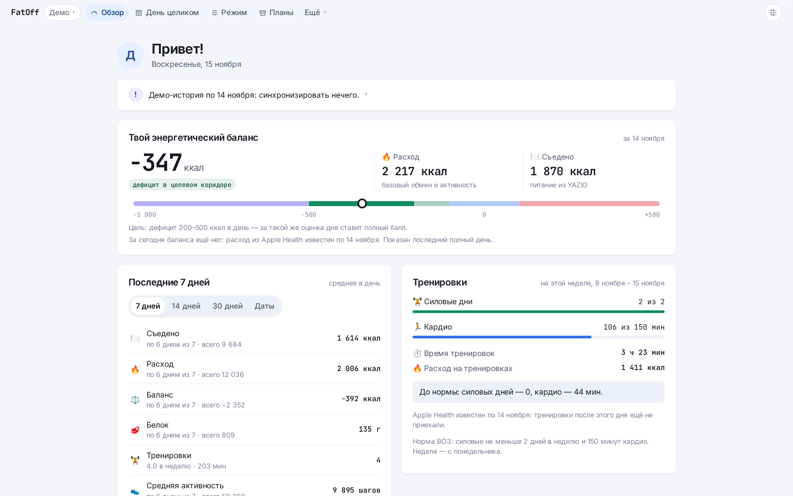
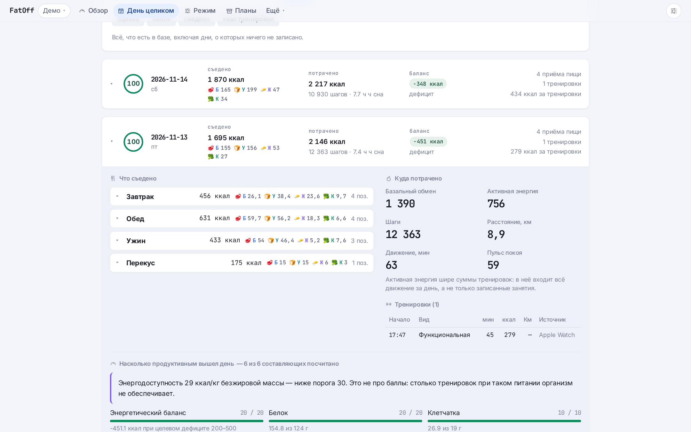
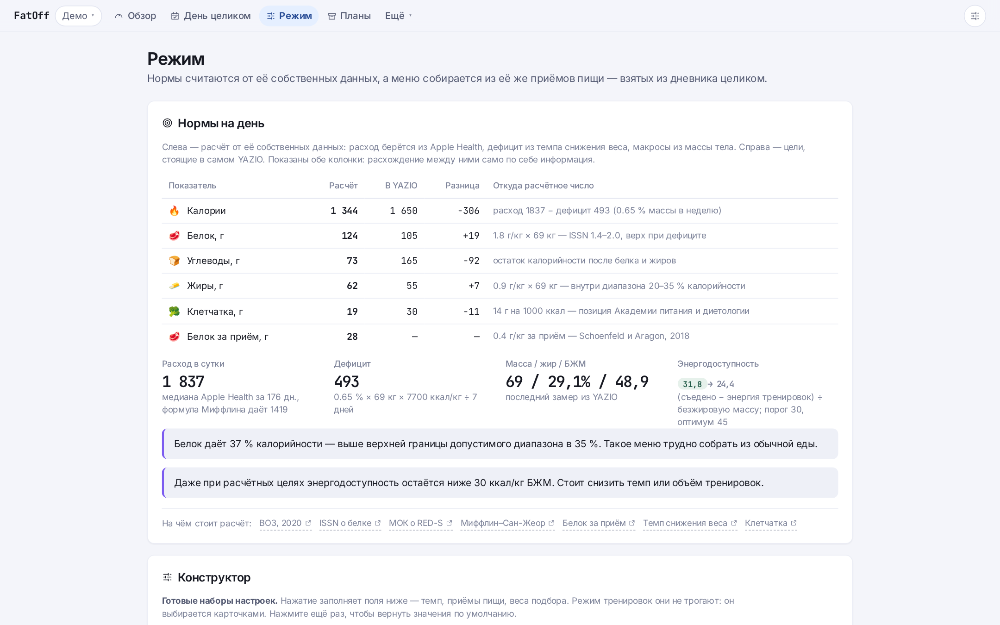
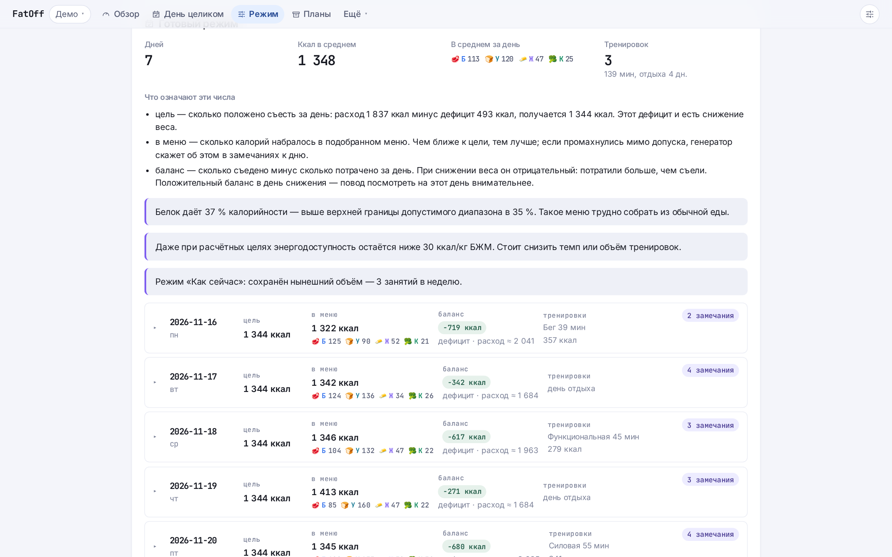
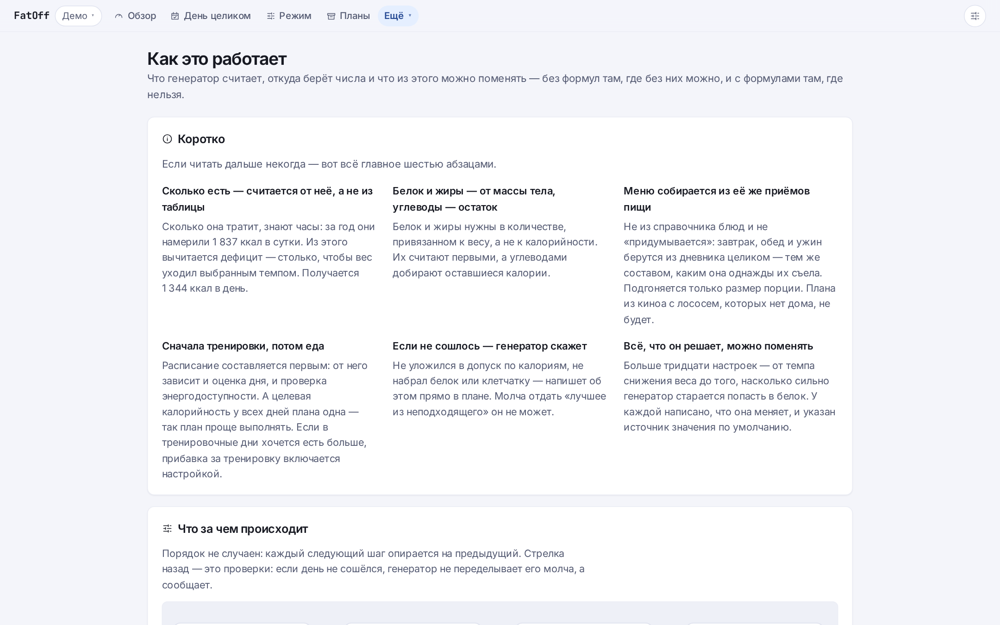
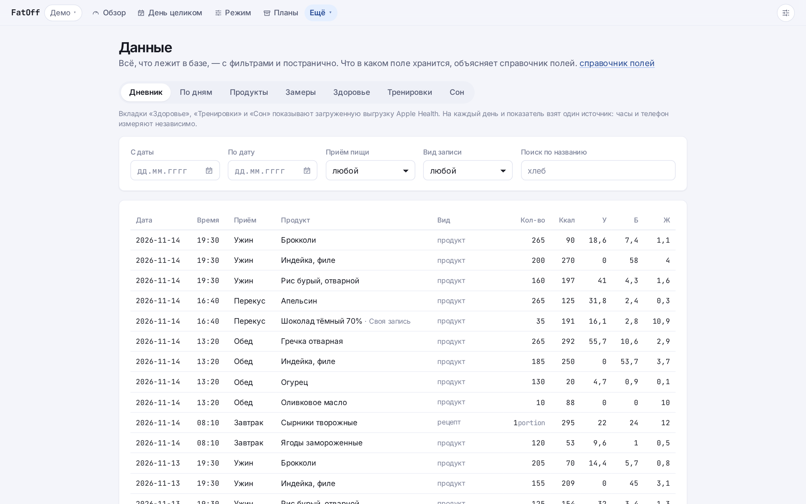
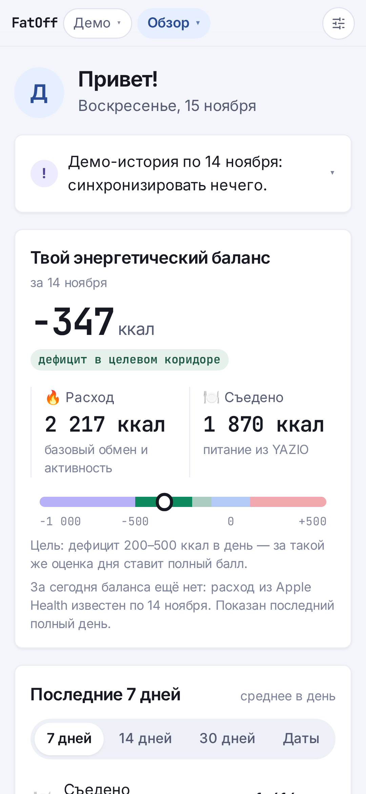

# FatOff

[English](README.md) · **Русский**

Локальный сервис: выгружает аккаунт [YAZIO](https://www.yazio.com/) в свою базу,
показывает состояние в браузере и собирает из накопленного файлы, которые можно
отдать языковой модели на анализ.



<sub>На всех снимках — встроенный демо-аккаунт: выдуманная история, данных живого человека нет.</sub>

- **Архитектура и план** — [docs/ARCHITECTURE.md](docs/ARCHITECTURE.md)
- **Apple Health: разбор и сведение** — [docs/APPLE-HEALTH.md](docs/APPLE-HEALTH.md)
- **Питание и тренировки: что говорят источники и её данные** — [docs/ANALYSIS-NUTRITION.md](docs/ANALYSIS-NUTRITION.md)
- **День целиком и генератор режима** — [docs/PLANNER-ARCHITECTURE.md](docs/PLANNER-ARCHITECTURE.md), [docs/PLANNER-PLAN.md](docs/PLANNER-PLAN.md)
- **Ветки, окружения и правила репозитория** — [docs/GIT.md](docs/GIT.md)
- **Публичный вход снаружи** — [docs/PUBLIC-ACCESS.md](docs/PUBLIC-ACCESS.md)
- **Выгрузка Apple Health из Google Drive** — [docs/DRIVE-IMPORT.md](docs/DRIVE-IMPORT.md)
- **Журнал решений** — [docs/DECISIONS.md](docs/DECISIONS.md)
- **Разобранное API YAZIO** — [docs/YAZIO-API.md](docs/YAZIO-API.md)

## Что умеет

- добавить аккаунт YAZIO по почте и паролю, проверив вход;
- добавить аккаунт, у которого пароля нет вовсе (вход через Apple ID), — по
  готовому токену;
- выгрузить историю от даты регистрации до сегодня, а дальше досинхронизировать
  только изменившееся — за счёт дешёвого детектора дневных итогов;
- открыть главный экран: баланс последнего полного дня со шкалой и целевым
  коридором, последние дни с графиком «съедено против расхода», тренировки недели
  против нормы ВОЗ, питание за сегодня и короткий анализ словами — у каждого числа
  сказано, откуда оно и по скольким дням посчитано;
- забрать выгрузку Apple Health из папки Google Drive — по расписанию или
  кнопкой, — распознать её по содержимому и загрузить, пропустив уже знакомый
  файл;
- загрузить выгрузку Apple Health и свести её с дневником питания по дням:
  YAZIO знает приход энергии, Apple Health — расход, вместе они дают баланс;
- смотреть всё загруженное прямо в браузере — с фильтрами и постранично;
- открыть день целиком: приход и расход рядом, раскрытие до состава каждого
  приёма пищи, разбор расхода по тренировкам и оценка дня с разбором;
- посчитать нормы от её собственных данных и показать их рядом с целями YAZIO;
- собрать режим на день, неделю, месяц или произвольный период: меню из её же
  приёмов пищи — завтрак, обед и ужин берутся из дневника целиком, тем же
  составом, — и расписание тренировок в одном из четырёх режимов, с шаблонами;
  готовый план правится руками — блюдо можно заменить, перевесить или закрепить;
- прочитать прямо в сервисе, как всё это считается: страница «Как это работает»
  объясняет формулы, порядок работы и каждую настройку человеческим языком;
- хранить готовые планы в своём разделе: метки, поиск по названию, страницы,
  просмотр плана целиком и выгрузка одним файлом PDF;
- собрать файл за произвольный период в четырёх форматах;
- держать несколько аккаунтов независимо.

Интерфейс — русский и английский, светлый и тёмный, с четырьмя цветовыми
гаммами на выбор (Tokyo Night, Catppuccin, Nord, Графит); переключается
мгновенно и целиком. Двуязычно всё: подписи, описания настроек, справочник
полей, документация генератора и файлы PDF. Сервер фраз не сочиняет — он
присылает код и числа, предложение собирает фронт (D-044).
Шрифты — Inter и JetBrains Mono — лежат рядом с сервисом: со страницы с данными
о здоровье не уходит ни одного внешнего запроса.

## Как это выглядит

**День целиком** — приход и расход рядом, приёмы пищи раскрываются до состава, тренировки и оценка дня с разбором:



**Режим** — нормы от её собственных данных рядом с целями YAZIO, у каждого числа источник:



**Собранная неделя** — приёмы пищи из дневника целиком, расписание тренировок, замечания там, где не сошлось:



**Как это работает** — генератор объясняет себя на числах самого аккаунта:



**Данные** — всё, что лежит в базе, с фильтрами и постранично:



**Тёмная тема и телефон:**

<p>
  
  
</p>

## Форматы выгрузки

| Формат | Что это | Когда брать |
|---|---|---|
| **Markdown** | готовый отчёт: профиль, сводка, ряд по дням, топ продуктов, микронутриенты, качество данных | вставить в чат с ИИ |
| **TOON** | все таблицы, но имена колонок один раз в заголовке — втрое компактнее JSON | длинная история, экономия токенов |
| **JSON** | полный машинный дамп всех таблиц | своя обработка |
| **CSV** | файл на таблицу, в zip | Excel, инструменты анализа |

Больше одного файла — на выходе zip.

## Запуск

```bash
cp .env.example .env
# заполнить APP_PASSWORD, SESSION_SECRET и SECRETS_KEY:
#   openssl rand -hex 32
# и пару приложения YAZIO — YAZIO_CLIENT_ID, YAZIO_CLIENT_SECRET (D-086):
#   в репозитории её нет, как достать — docs/YAZIO-API.md
pnpm docker:up    # база и приложение одним стеком: 4090
```

Прод — один стек `fatoff`: база и приложение в одном файле, как и у develop.

Сервис на `http://localhost:4090`. Вход — по `APP_PASSWORD`.

Дальше: «Добавить» → почта и пароль YAZIO → «Синхронизировать» → «Выгрузить файл».

**Нечего загружать?** На странице аккаунтов есть кнопка «Создать демо»: она
соберёт аккаунт с выдуманной, но правдоподобной историей за полгода — дневник
питания, шаги, сон, тренировки, взвешивания и один готовый план. Все разделы
работают на нём так же, как на настоящих данных: никакой отдельной ветки для
демо в расчётах нет (D-068). Синхронизировать его нечем, зато можно собрать
заново — история заканчивается вчерашним днём и со временем стареет.

Разделы аккаунта: **Обзор** (главный экран: баланс, последние дни, тренировки, питание, анализ), **Дни** (день целиком),
**Режим** (генератор), **Планы** (сохранённое), **Как это работает**
(документация), **Данные** (просмотр), **Синхронизация** (выгрузка, Apple Health,
доступ), **Выгрузка файла**.

## Ветки и окружения

Три ветки — три окружения, и они не пересекаются (D-043, D-057):

| ветка | что это | порт | база | как поднимается |
|---|---|---|---|---|
| `main` | прод | 4090 | `fatoff` в `fatoff-postgresql` (5482) | `pnpm db:up && pnpm docker:up` |
| `develop` | общая проверка | 4092 | `fatoff` в `fatoff-develop-postgresql` (5483) | `pnpm develop:up` |
| `feature/*` | своя работа | 4290 API, 4291 фронт | `fatoff_dev` в базе develop | `pnpm run dev` |

У каждого окружения свои контейнеры, свой том и своя сеть. Фича-ветки в докер не
уезжают: их запускают локально, и локальный сервер слушает все интерфейсы —
работу видно с телефона и с соседней машины по адресу вида
`http://<ip-этой-машины>:4291`.

**Порядок один и обратного хода не имеет (D-069):**

1. работа идёт в своей ветке — `feature/<что-делаем>` от `develop`;
2. показывается **из этой же ветки**, на локальном контуре;
3. и только после согласия человека сливается в `develop`;
4. проверенное на `develop` — в `main`, тоже с согласия.

Прямой коммит в `main` и в `develop` запрещён хуком: обе ветки собираются
слиянием. Согласие передаётся явно, иначе слияние не пройдёт:

```bash
APPROVED_BY="кто одобрил" git merge --no-ff feature/<что-делаем>
```

Подставлять туда что попало, не спросив, — то же самое, что слить без спроса.

## Разработка

```bash
pnpm install
git config core.hooksPath .githooks    # проверка секретов перед коммитом
pnpm develop:up                        # окружение develop: база 5483, сервис 4092
pnpm --filter @fatoff/api run dev      # backend локально на :4290
pnpm --filter @fatoff/web run dev      # фронт на :4291, /api проксируется на backend
```

Фронт слушает `0.0.0.0`, поэтому ветку задачи можно открыть не только на этой
машине: `http://<ip-этой-машины>:4291`. Ради этого он так и настроен — работу
полагается показывать из своей ветки, а не после слияния (D-069).

Локальная база наполняется копией рабочей — её не жалко:

```bash
docker exec fatoff-postgresql pg_dump -U fatoff fatoff > /tmp/fatoff.sql
docker exec -i fatoff-develop-postgresql psql -U fatoff -c 'create database fatoff_dev'
docker exec -i fatoff-develop-postgresql psql -U fatoff fatoff_dev < /tmp/fatoff.sql
```

## Что не попадает в репозиторий

Репозиторий публичный, а сервис работает с дневником питания и историей
здоровья живого человека. В git не уезжают ни секреты (`.env`, `secrets/`,
ключи), ни чужие данные (выгрузка Apple Health, дампы базы, собранные файлы),
ни опознающие следы — почты, имена, живые замеры тела. В документах и тестах
стоят условные значения. Чужого секрета тоже нет: пара OAuth приложения YAZIO
приходит из `.env` (D-086).

Проверку делает хук перед коммитом; он же доступен руками:

```bash
pnpm scan        # весь репозиторий
pnpm scan:test   # тесты самой проверки
```

Тесты:

```bash
pnpm test                                  # всё
pnpm --filter @fatoff/api run test             # backend
YAZIO_CLIENT_ID=… YAZIO_CLIENT_SECRET=… YAZIO_EMAIL=… YAZIO_PASSWORD=… \
  pnpm --filter @fatoff/api run check:yazio    # живы ли эндпоинты YAZIO
```

Интеграционные тесты поднимают свои базы (`fatoff_test_*`) на том же
PostgreSQL и подставной сервер YAZIO — сеть им не нужна.

Интерфейс проверяется в браузере: прогон раскрывает день, собирает режим,
переключает язык и ищет забытые переводы, слишком слабый контраст, повторяющиеся
`id` и горизонтальную прокрутку на 390 px (D-045):

```bash
pnpm exec playwright install chromium          # один раз
ACCOUNT=<uuid> SHOTS=/tmp/shots pnpm --filter @fatoff/web run check:ui
```

Снимки для README снимаются с демо-аккаунта на отдельной пустой базе — в базе
разработки лежит копия рабочей, и живые данные попали бы в кадр. Скрипт сам
отказывается снимать, если в базе есть хоть один настоящий аккаунт:

```bash
docker exec fatoff-develop-postgresql psql -U fatoff -d postgres -c 'create database fatoff_shots'
pnpm --filter @fatoff/web build
cd apps/api && DB_NAME=fatoff_shots SCHEDULES_ENABLED=false node dist/main   # не через turbo: он съест DB_NAME
BASE=http://localhost:4290 PASSWORD=… pnpm --filter @fatoff/web run screenshots
```

Миграции генерируются из сущностей, руками SQL никто не пишет:

```bash
pnpm --filter @fatoff/api run migration:create
pnpm --filter @fatoff/api run migration:up
```

## Apple Health

Выгрузка Apple Health — это файл на два гигабайта, через форму браузера такой не
загрузить. Каталог с ней монтируется в контейнер только на чтение, а сервис
показывает, что в нём лежит:

```bash
# распакованную выгрузку положить сюда
apple-health/apple_health_export/экспорт.xml
```

Дальше на странице аккаунта — «Apple Health» → выбрать файл → «Загрузить».
Замерено на настоящей выгрузке: **4.4 миллиона записей, 95 типов, 8.6 лет — 21
секунда**.

Что появляется после загрузки:

- вкладки «Здоровье», «Тренировки» и «Сон» в просмотре данных;
- таблицы `health_daily`, `health_workouts`, `health_sleep` в выгрузке;
- таблица **`daily_combined`** — день из обоих источников с балансом энергии;
- раздел «Расход и баланс энергии» в Markdown-дайджесте.

Три вещи, из-за которых наивный импорт Apple Health врёт, и что с ними сделано,
разобраны в [docs/APPLE-HEALTH.md](docs/APPLE-HEALTH.md): дублирование данных
между часами и телефоном, запись YAZIO в Health под видом второго источника и
сон, пересекающий полночь.

## Устройство

```
apps/api        NestJS 11, MikroORM 6, PostgreSQL 17 — выгрузка, хранение, сборка файлов
apps/web        Nuxt 4 в режиме SPA, раздаётся самим backend
packages/contracts   общие типы, реестр нутриентов и справочник полей
apple-health    сюда кладётся выгрузка Apple Health (в репозиторий не попадает)
infrastructure  docker-compose для PostgreSQL
docs            архитектура, журнал решений, разбор API, Apple Health, нормы питания
```

Сырые ответы YAZIO хранятся в базе как есть, а таблицы выгрузки считаются из них
при сборке файла. Поэтому изменение правил подсчёта не требует повторной
выгрузки из YAZIO, а вся арифметика живёт в чистых функциях и покрыта тестами.

Тем же принципом устроен генератор режима: нормы, оценка дня, пул продуктов,
подбор меню и расстановка тренировок — чистые функции без базы и сети, сервис
только достаёт для них строки.

## Нормы и рекомендации

Числа, на которых стоит генератор, взяты не с потолка: руководство ВОЗ 2020 по
физической активности, позиционный доклад ISSN по белку, консенсус МОК по RED-S,
формула Миффлина–Сан-Жеора, работы о распределении белка по приёмам пищи и о
темпе снижения веса. Каждое расчётное число в интерфейсе подписано тем, откуда
оно взялось; разбор — в [docs/ANALYSIS-NUTRITION.md](docs/ANALYSIS-NUTRITION.md).

Это разбор данных по опубликованным рекомендациям, а не медицинское заключение.

## Оговорки

Сервис не даёт медицинских советов: он считает по опубликованным рекомендациям
и показывает, откуда взялось каждое число. Решения принимает человек, при
необходимости — вместе с врачом.

API YAZIO не документировано и может измениться в любой момент — проект с YAZIO
никак не связан. Версия пути (`v9`) вынесена в `YAZIO_API_VERSION`.

### Аккаунт с входом через Apple ID

Пароля у такого аккаунта не существует, а реализовать «Вход через Apple» на
своей стороне нельзя — обменять токен Apple на токен YAZIO может только клиент,
зарегистрированный у Apple. Но у YAZIO есть **веб-страница входа, где кнопка
«Continue with Apple» работает**, и выданный там токен ничем не отличается от
токена приложения.

**Как добавить такой аккаунт — минута в браузере:**

1. Открыть <https://www.yazio.com/en/app/account/login>, нажать `F12`, вкладка
   «Сеть» (Network).
2. Войти кнопкой «Continue with Apple».
3. Найти запрос `POST /api/auth/token`, открыть вкладку «Ответ» (Response) и
   скопировать тело целиком.
4. В экспортёре: «Добавить» → «Готовый токен» → вставить в первое поле.
   `access_token` и `refresh_token` разложатся сами.

Проверено на живом аккаунте: токен, выданный сайтом, принимается
`yzapi.yazio.com/v9`, и обновляется парой client_id приложения — то есть сервис
умеет продлевать его сам, и повторно ничего доставать не придётся.

**Запасной путь — перехват трафика телефона.** Нужен, только если веб-вход по
какой-то причине не сработал. Приложение YAZIO не защищено от прослушки (вся
спецификация API сообщества собрана перехватом), в проекте есть готовый
перехватчик:

```bash
mitmdump -s apps/api/scripts/capture-token.py                    # только показать
YZ_URL=http://localhost:4090 YZ_PASSWORD=<пароль> YZ_LABEL=второй \
  mitmdump -s apps/api/scripts/capture-token.py                  # и завести аккаунт
```

На телефоне: прописать компьютер прокси-сервером (порт 8080), открыть
`http://mitm.it`, поставить сертификат и включить его в «Настройки → Основные →
Об этом устройстве → Доверие сертификатам». Затем в YAZIO выйти и зайти заново
через Apple. Перехваченный трафик содержит токены и данные о здоровье — не
хранить и никуда не выкладывать; после перехвата снять прокси на телефоне.

Аккаунт без пароля живёт, пока YAZIO не отзовёт refresh-токен; после этого
синхронизация упадёт с внятным сообщением, и токен нужно будет заменить на
странице аккаунта.

Пароль от YAZIO хранится в базе зашифрованным (AES-256-GCM), ключ — в `.env`,
вне базы. Он нужен, чтобы ночная синхронизация продолжала работать после того,
как YAZIO отзовёт токен. Выставлять сервис наружу не предполагается.
